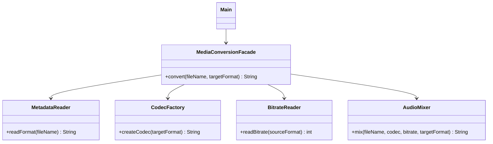

# Assignment 4 | Facade

- **Name:** Alikhan Smagul
- **Group:** SE-2529
- **Repository:**  https://github.com/alihzzz/SDP_Assignment4.git


## Idea
Converting a media file needs several steps: read metadata, choose a codec,
read the bitrate, mix the audio. The client should not do all of this itself.
`MediaConversionFacade` hides these steps behind one method:

```java
converter.convert("song.wav", "mp3");
```

## Structure
```
src/
  subsystem/   MetadataReader, CodecFactory, BitrateReader, AudioMixer
  facade/      MediaConversionFacade
  client/      Main
```

## UML class diagram


## How to run
```
javac -d out $(find src -name "*.java")
java -cp out client.Main
```
Or open the folder in IntelliJ IDEA and run `client.Main`.
